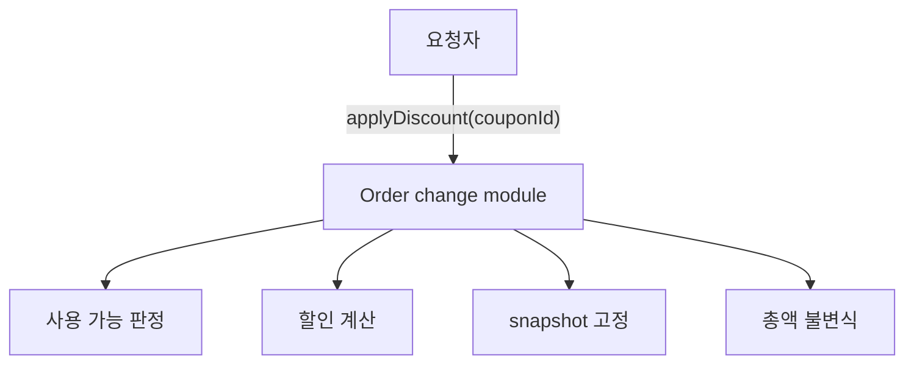

<aside>
🎯

**이 장의 목표** — 모호한 요구에서 개발자의 추측과 확인된 정책을 분리합니다.

**읽고 나서 할 수 있는 판단** — 번호가 붙은 규칙과 반례로 주문 동작을 설명하고, 구현자가 의존할 인터페이스를 설계합니다.

</aside>

## 쿠폰 한 줄이 정책을 대신 결정할 때

기획 티켓에는 한 문장만 적혀 있습니다. “주문에 쿠폰을 적용할 수 있어야 해요.” 개발자가 서둘러 쿠폰 ID를 받는 API를 만들면 기능은 금방 동작합니다. 그런데 첫 리뷰에서 질문이 쏟아집니다. 다른 사람의 쿠폰도 쓸 수 있는가? 주문을 확정한 뒤 정책이 바뀌면 금액도 바뀌는가? 같은 요청을 다시 보내면 할인이 두 번 적용되는가?

처음 구현은 틀린 코드를 작성해서 실패한 것이 아닙니다. **정해지지 않은 업무 정책을 코드가 대신 결정해서** 실패했습니다. 그렇다고 모든 답을 기다리면 개발을 시작할 수 없습니다. 먼저 문장에서 직접 확인되는 내용, 지금만 임시로 정한 내용, 답에 따라 사용자에게 보이는 동작이 달라지는 질문을 나눠야 합니다.

이 분류만으로도 부족합니다. 어떤 실행 경로에서도 지켜야 할 업무 규칙을 반례와 함께 적고, 호출자가 의존할 인터페이스와 오류 의미를 고정해야 다른 구현으로 바뀌어도 약속이 흔들리지 않습니다. AI는 여기서 답을 대신 내는 도구가 아니라, 빠진 질문과 충돌하는 규칙을 찾아내는 두 번째 독자입니다.

## 질문이 설계 기록이 되기까지

```
모호한 한 문장 (e.g ~~ 개발해주세요.)
  → 그대로 구현하면 개발자가 정책을 결정한다
  → 문장에 적힌 약속과 아직 답이 필요한 질문을 나눈다
  → 반례로 반드시 지킬 규칙을 찾는다
  → 사용자에게 보이는 인터페이스와 오류 의미를 정한다
  → 빠진 조건과 충돌하는 규칙을 다시 살핀다
  → 테스트와 코드로 옮길 수 있는 설계 기록을 남긴다
```

이 흐름에서 **불변식(invariant)**은 “항상 지켜야 할 업무 사실”, **인터페이스(interface)**는 “사용자가 기대할 수 있는 작은 약속”이라는 뜻으로 뒤에서 정확히 다룹니다. 비유가 멈추는 지점도 분명합니다. 문서를 잘 썼다고 구현이 맞아지는 것은 아닙니다. 설계 기록은 실패하는 예와 실제 코드로 다시 확인해야 합니다.

## 읽고 나서 설명할 수 있어야 할 것

1. 한 문장의 요구를 왜 바로 코드로 옮기면 안 될까?
2. 문장에 적힌 약속과 아직 답이 필요한 질문을 섞으면 어떤 결함이 생길까?
3. 업무 규칙은 왜 반례와 함께 써야 할까?
4. 인터페이스는 무엇을 안정시키고 무엇을 구현 안에 숨겨야 할까?
5. 도구가 제안한 규칙을 어떤 근거로 채택하거나 거절해야 할까?

## 왜 요구를 바로 코드로 옮기면 안 될까

“쿠폰 적용”에는 여러 시스템이 숨어 있습니다.

- 구매자만 가능한가, 운영자도 가능한가?
- 주문 확정 전만 가능한가?
- 같은 쿠폰을 두 번 요청하면 누적되는가, 같은 결과를 돌려주는가?
- 상품 가격이나 쿠폰 정책이 바뀌면 과거 주문 금액도 바뀌는가?
- 쿠폰 없음, 소유자 다름, 기간 만료는 요청자에게 같은 실패인가?

답하지 않은 채 endpoint와 class를 만들면 우연한 구현이 정책이 됩니다. 설계는 미래를 모두 맞히는 일이 아니라 **확인된 결정, 임시 선택, 아직 열린 결정을 분리하고 변경의 파급을 경계 안에 가두는 일**입니다.


## 주문 흐름에서 먼저 지킬 약속

첫 티켓만으로는 구현을 시작하기에 부족합니다. 제품 담당자와 범위를 확인한 뒤 기준 문장을 다음처럼 고쳤다고 합시다. “구매자는 주문 확정 전에 보유 쿠폰을 적용할 수 있고, 확정된 할인 금액은 나중에 바뀌지 않아야 한다.” 여기서 구매자, 확정 전, 확정 금액 보존은 문장에 적힌 약속입니다.

구현에 들어가려면 네 가지 동작도 분명해야 합니다. 한 주문에는 쿠폰 한 장만 적용하고, 할인액은 0원부터 주문 원금 사이여야 합니다. 같은 주문과 쿠폰으로 다시 요청하면 첫 결과를 돌려주며, 쿠폰 만료 여부는 요청을 받은 시각으로 판단합니다. 이 네 가지는 이 장에서 다루는 주문 흐름의 조건입니다. 실제 제품에서는 복수 쿠폰, 운영자 강제 할인, 환불·정산과 결합될 수 있으므로 그대로 일반화하면 안 됩니다.

여기서 설계자가 정할 것은 업무 규칙 자체가 아니라 **규칙을 지키는 경계**입니다. 어떤 객체가 할인 결과를 고정할지, 실패를 어떤 도메인 오류로 표현할지, HTTP 응답에 어떤 의미를 공개할지, 저장소나 외부 정책 조회를 어느 인터페이스 뒤에 둘지를 선택하고 이유를 설명해야 합니다.

#### `INV-001` · 주문 소유권

구매자는 자신이 소유한 주문만 바꿉니다. 다른 `X-USER-ID`로 같은 주문을 요청했을 때 주문 존재를 노출하지 않고 거절되는지가 가장 작은 반례입니다.

#### `INV-004` · 확정 결과 보존

주문 확정 뒤 할인 금액은 바뀌지 않습니다. 정책을 10%에서 20%로 바꾼 뒤에도 저장된 최종 금액이 같아야 이 규칙이 살아 있습니다.

- 주문 처리에서 함께 지켜야 할 네 규칙
    - `INV-002`: 확정 전 한 주문에는 보유 쿠폰 한 장만 적용합니다.
    - `INV-003`: `finalAmount = originalAmount - discountAmount`이며 할인액은 0과 원금 사이입니다.
    - `INV-005`: 같은 주문·쿠폰 재요청은 저장된 결과를 돌려주고 효과를 늘리지 않습니다.
    - `INV-006`: 만료 여부는 요청 시작 시각으로 판단합니다.

  각 규칙에는 깨지는 입력과 외부 응답을 붙입니다. 번호는 문서·테스트·지표가 같은 뜻을 가리키게 하므로 의미를 바꿔 재사용하지 않습니다.


AI가 새 규칙이나 예외를 제안하더라도 그 문장 자체가 제품 정책이 되지는 않습니다. 요구 문장, 공식 정책, 현재 동작에서 확인할 수 없는 제안은 후보로만 남기고 담당자의 답이 필요한 질문으로 바꿉니다. 예를 들어 “쿠폰은 가족 계정과 공유할 수 있다”는 제안은 소유권 규칙을 바꾸므로, 근거 없이 모델이나 코드에 넣으면 안 됩니다.

- 더 깊이 보기 · 불변식과 오류 타입을 꼭 일대일로 만들어야 할까?

  ### 불변식 하나마다 오류 클래스 하나가 필요할까?

  불변식과 도메인 오류를 일대일로 만들면 규칙의 출처를 추적하기 쉽지만, 규칙이 늘 때 클래스가 폭증하고 HTTP 응답까지 도메인 타입에 묶일 수 있습니다. 다음 대안도 가능합니다.

  **표현 방법 · 안정된 업무 오류 코드 + 구조화된 문맥**

    - **장점** — API·로그·다국어 메시지에서 코드가 안정적
    - **주의할 점** — 문맥 필드의 의미를 관리해야 함
    - **어울리는 상황** — 외부 API와 운영 지표가 같은 실패를 추적할 때

  **표현 방법 · 작은 타입 계층**

    - **장점** — 컴파일러가 실패 종류를 구분하고 공통 처리가 쉬움
    - **주의할 점** — 세부 규칙마다 하위 타입을 만들면 다시 폭증
    - **어울리는 상황** — 실패 가족별 복구 정책이 다를 때

  **표현 방법 · 결과 타입 또는 Kotlin sealed type**

    - **장점** — 성공과 예상 가능한 실패를 호출자가 명시적으로 처리
    - **주의할 점** — 예외 기반 프레임워크와 변환 경계가 필요
    - **어울리는 상황** — 도메인 흐름 안에서 분기가 중요한 경우

  **표현 방법 · 도메인 실패와 HTTP 변환 분리**

    - **장점** — 도메인이 전송 기술을 모름
    - **주의할 점** — 변환 표가 누락되면 외부 응답이 흔들림
    - **어울리는 상황** — 같은 도메인을 HTTP·배치·이벤트가 함께 사용할 때

  핵심은 클래스 수가 아니라 **업무 의미가 안정적으로 식별되고, 요청자의 다음 행동과 운영 관찰이 가능하며, 전송 계층이 도메인 규칙을 왜곡하지 않는가**입니다.


## 요구 문장에서 약속을 읽는 법

요구 문장에 직접 적힌 약속은 그대로 지켜야 합니다. 설계를 시작하기 위해 임시로 둔 판단은 쉽게 되돌릴 수 있도록 영향 범위를 남깁니다. 답에 따라 사용자 응답, 저장 데이터, 권한이 달라지는 빈칸은 제품 담당자가 답해야 할 질문입니다. 세 가지를 구분해야 개발자의 추측이 조용히 정책이 되는 일을 막을 수 있습니다.

**분류 ·** 문장에 적힌 약속

- **판정 질문** — 요구 문장이나 공식 정책에서 근거를 가리킬 수 있는가?
- **예시** — 주문 확정 뒤 할인 결과는 변하지 않는다.
- **다음 행동** — 불변식과 성공 조건에 반영

**분류 ·** 임시로 둔 판단

- **판정 질문** — 답을 기다리는 동안 선택했으며 틀리면 되돌릴 수 있는가?
- **예시** — 한 주문에는 쿠폰 한 장만 허용한다.
- **다음 행동** — 영향 범위와 반례를 남기고 확인

**분류 ·** 담당자가 답할 질문

- **판정 질문** — 답에 따라 사용자 응답이나 데이터 의미가 달라지는가?
- **예시** — 운영자 강제 할인도 같은 권한 규칙을 따르는가?
- **다음 행동** — 답하기 전에는 제품 정책으로 만들지 않음

“보통 그렇다”는 문장에 적힌 약속이 아닙니다. 반대로 모든 문장을 질문으로 남기면 설계가 멈춥니다. **틀렸을 때 데이터 의미, 권한, 요청자의 다음 행동이 달라지는 질문**부터 찾습니다.

### 하나의 요구를 끝까지 분해해 보기

앞에서 확인한 기준 문장을 다시 읽어 봅시다. 구매자와 확정 뒤 금액 보존은 문장에 적힌 약속입니다. 반면 운영자도 다른 사람의 주문에 쿠폰을 적용할 수 있는지는 답이 없습니다. 권한과 감사 기록이 달라지므로 제품 담당자가 답해야 합니다.

“쿠폰은 한 장만 가능하다”를 모든 제품의 사실처럼 다루면 복수 쿠폰 정책을 수용할 API와 데이터 구조를 처음부터 닫아 버립니다. 이 장의 주문 흐름은 한 장만 받지만, 인터페이스 안에 배열이나 우선순위 정책까지 미리 넣지는 않습니다. 반대로 “확정 금액은 변하지 않는다”를 임시 판단처럼 다루면 최신 정책 재계산이 과거 결제 금액을 바꾸는 결함을 만들 수 있습니다. 구분의 목적은 문서 형식이 아니라 **오래 지킬 약속과 나중에 바꿀 선택을 가르는 것**입니다.

## 사용자와 사용 장면

설계에서 **액터(actor)**는 시스템과 목적을 가지고 상호작용하는 사람이나 다른 시스템입니다. 단순히 HTTP 요청을 보낸 주체보다 넓습니다. 구매자, 판매자, 운영자, 정산 시스템은 같은 주문을 보더라도 권한과 성공 기준이 다릅니다. **유스 케이스(use case)**는 한 액터가 목적을 달성하는 시작부터 성공·실패 뒤 상태까지의 사용 장면입니다.

```
Use case UC-01: 주문에 쿠폰 적용
주 사용자: 구매자
시작 조건: 구매자 소유 주문이며 아직 확정되지 않음
시작 사건: couponId 선택
성공 결과: 할인 결과 기록과 최종 주문 금액 반환
실패 결과: 주문 없음 / 소유자 다름 / 주문 확정 / 쿠폰 사용 불가
종료 조건: 성공한 할인 결과 기록은 이후 정책·가격 변화에도 동일
```

“CouponService를 만든다”는 use case가 아닙니다. class는 약속을 지키는 수단입니다.

## 반드시 지킬 규칙과 구현 범위

- **불변식(invariant)**: 어떤 실행 경로를 거쳐도 성공한 시스템 상태에서 항상 참이어야 하는 관계. 예: `최종 주문 금액 = 품목 합계 - 확정 할인액`.
- **제약 조건(constraint)**: 이번 구현에서 선택할 수 있는 범위를 제한하는 조건. 예: 한 주문·한 쿠폰, 외부 결제 시스템 없음, 공통 프로젝트 안에서 구현.

불변식은 class 이름이 아니라 관찰 가능한 상태 관계로 씁니다. “Order 엔티티를 쓴다”는 invariant가 아닙니다.

### 반례로 다듬기

`할인액은 주문 금액보다 작다`는 문장은 100% 할인에서 깨집니다. 의도가 전액 할인 허용이라면 `0 ≤ 할인액 ≤ 품목 합계`가 정확합니다. 같은 couponId 재요청이 할인액을 두 번 누적한다면 주문당 하나라는 불변식도 깨집니다.

## 인터페이스와 오류 응답

**인터페이스(interface)**는 Java/Kotlin 키워드만 뜻하지 않습니다. HTTP 주소, 공개 메서드, 이벤트 형식처럼 서로 다른 구성 요소가 의존하는 약속을 모두 포함합니다. 좋은 인터페이스는 내부 구현을 몰라도 올바르게 사용할 수 있게 합니다.

좋은 interface는 요청자가 다음을 알게 합니다.

- 무엇을 제공하는가?
- 성공하면 무엇을 관찰하는가?
- 실패마다 어떤 다음 행동이 가능한가?
- 내부의 어떤 결정은 보이지 않는가?

공통 프로젝트의 reference:

- `apps/commerce-api/src/main/{java|kotlin}/com/loopers/interfaces/api/example/ExampleV1ApiSpec.{java|kt}`
- `ExampleV1Controller.{java|kt}`, `ApiControllerAdvice.{java|kt}`, `ApiResponse.{java|kt}`
- `apps/commerce-api/src/test/{java|kotlin}/com/loopers/interfaces/api/ExampleV1ApiE2ETest.{java|kt}`

**입력 · 존재하는 숫자 ID**

- **계약** — 정상 조회
- **HTTP** — 2xx
- **요청자 행동** — 응답 사용

**입력 · `abc`**

- **계약** — 문법 오류
- **HTTP** — 400
- **요청자 행동** — 입력 수정

**입력 · 없는 숫자 ID**

- **계약** — 대상 자원 없음
- **HTTP** — 404
- **요청자 행동** — 재조회·대체 흐름

**입력 · 연결되지 않은 URL**

- **계약** — 요청 처리기 없음
- **HTTP** — 별도 경계
- **요청자 행동** — 경로 수정

모두 “4xx”로 합치면 테스트는 짧아지지만 요청자가 입력을 고칠지 대상을 다시 찾을지 판단할 정보를 잃습니다.

## 정보 은닉과 깊은 모듈

**정보 은닉(information hiding)**은 필드를 `private`로 만드는 일이 아니라 **변경 이유를 경계 안에 가두는 일**입니다. **깊은 모듈(deep module)**은 작은 인터페이스 뒤에서 여러 정책과 처리 순서를 책임져, 호출자가 알아야 할 개념을 줄이는 모듈입니다.

요청자가 `가격 조회 → 쿠폰 조회 → 검증 → 할인 계산 → 총액 재계산` 순서를 직접 알아야 한다면 할인 정책에 결합됩니다. 반대로 `order.applyDiscount(coupon)`이 불변식을 지키고 snapshot을 남기면 interface는 작고 내부 책임은 깊습니다.



- **얕은 module**: public method가 많고 요청자가 내부 순서를 안다.
- **깊은 module**: 작은 interface 뒤에서 정책과 상태 전이를 함께 책임진다.

깊은 module은 거대한 class가 아닙니다. 노출하는 개념보다 감추는 결정이 많다는 뜻입니다.

## 응집도, 결합도, 의존 방향

<aside>


**개념 · 응집도(cohesion)**

- **판단 질문** — 같은 이유로 바뀌는 규칙이 함께 있는가?
- **경고 신호** — 할인 변경 때문에 관계없는 컨트롤러까지 수정
</aside>

<aside>


**개념 · 결합도**

- **판단 질문** — 한 선택을 바꿀 때 몇 경계를 알아야 하는가?
- **경고 신호** — 요청자가 repository·정책·계산 순서를 모두 앎
</aside>

<aside>


**개념 · 의존 방향**

- **판단 질문** — 업무 규칙이 detail을 아는가, detail이 규칙의 port를 구현하는가?
- **경고 신호** — 도메인 규칙이 JPA/HTTP 타입 없이는 표현 불가
</aside>

의존성 역전은 interface 수를 늘리는 규칙이 아닙니다. 안정되어야 할 업무 결정이 자주 바뀌는 상세를 직접 알지 않게 하는 선택입니다. 실제로 숨기는 변화가 없다면 port 하나를 더 만드는 것은 얕은 wrapper일 뿐입니다.

## 오래 지킬 경계를 고르는 질문

1. 누가 interface를 소비하는가?
2. 이 결정이 틀리면 데이터 의미나 요청자 행동이 바뀌는가?
3. 구현 상세가 바뀌어도 유지할 invariant는 무엇인가?
4. 예상 변화보다 지금 추상화 비용이 더 큰가?
- 더 깊이 보기 · 확정값 저장과 최신값 재계산 비교

  ### 사례로 따라가기 · 할인 재계산 vs snapshot

  **대안 · 조회 때마다 재계산**

    - **장점** — 최신 정책 반영, 저장 값 감소
    - **비용·위험** — 과거 확정 금액이 바뀜
    - **맞는 상황** — 아직 확정 전인 견적

  **대안 · 확정 시 snapshot**

    - **장점** — 과거 주문 금액과 판단 근거 안정
    - **비용·위험** — snapshot·생성 책임 필요
    - **맞는 상황** — 결제·감사 기준이 되는 주문

  확정 주문에는 두 번째가 맞습니다. 기술 취향이 아니라 `확정 주문 금액은 이후 정책 변화로 바뀌지 않는다`는 invariant 때문입니다. 반대로 실시간 환율 견적처럼 “현재 값”이 계약인 화면에서는 snapshot이 오히려 틀린 선택일 수 있습니다.


## 문서와 실제 동작을 연결하는 테스트

여기서 실행하는 테스트는 새 제품 기능을 만드는 테스트 주도 개발이 아닙니다. 이미 존재하는 `/api/v1/examples`의 동작이 문서의 설명과 일치하는지 누구나 같은 방법으로 확인하는 실행 가능한 예시입니다.

```bash
./gradlew :apps:commerce-api:test --tests '*ExampleV1ApiE2ETest'
./gradlew :apps:commerce-api:test --tests 'com.loopers.interfaces.api.ContractClassificationTest'
git diff --name-only -- apps/commerce-api/src/main
```

`ContractClassificationTest`는 `RANDOM_PORT + TestRestTemplate`로 실제 HTTP를 통과합니다. 정상, 문법 오류, 미존재, 미매핑을 분리하고 마지막 명령은 빈 출력이어야 합니다.

<aside>
🔒

이 단계에서는 제품 코드를 바꾸지 않습니다. 현재 동작을 다른 사람도 같은 방식으로 확인하는 테스트와, 다음 구현에서 사용할 설계 기록만 남깁니다.

</aside>

## 파일 업로드 정책에서 같은 질문을 써 보기

파일 업로드 API의 “업로드 성공”을 설계한다면 사용자, 최대 크기, 중복 파일, 바이러스 검사 중 상태, 저장 완료와 처리 완료 중 무엇이 문장에 적힌 약속이고 무엇이 제품 담당자가 답할 질문일까요? 어떤 상태를 2xx 한 종류로 합치면 요청자의 다음 행동을 잃게 될까요?

## 스스로 확인하기

- [ ]  요구 원문과 내가 추가한 가정을 분리했는가?
- [ ]  사용자마다 성공·실패 뒤 행동을 설명할 수 있는가?
- [ ]  반드시 지킬 규칙을 상태 관계로 썼는가?
- [ ]  인터페이스가 숨기는 변경 이유를 말할 수 있는가?
- [ ]  그럴듯하지만 틀린 선택과 이 기법이 맞지 않는 경우를 구분했는가?
- [ ]  구현할 약속과 아직 제품 담당자의 답이 필요한 질문을 분리했는가?

---

규칙의 출처와 반례를 정리했으니, Example API를 관찰해 설계가 실제 요청과 오류를 설명하는지 확인합니다.

## 이제 쿠폰 요구를 직접 좁혀 보기

실습에서는 Example API의 오류 응답을 관찰한 뒤 주문 할인 요구의 빈칸과 충돌을 찾습니다. 결과는 코드가 아니라 **다른 개발자가 판단의 출처와 선택을 따라갈 수 있는 설계 기록**입니다. 다음 구현에서는 그 기록의 요구사항 번호와 입력·결과 예시를 테스트와 제품 코드로 옮깁니다.